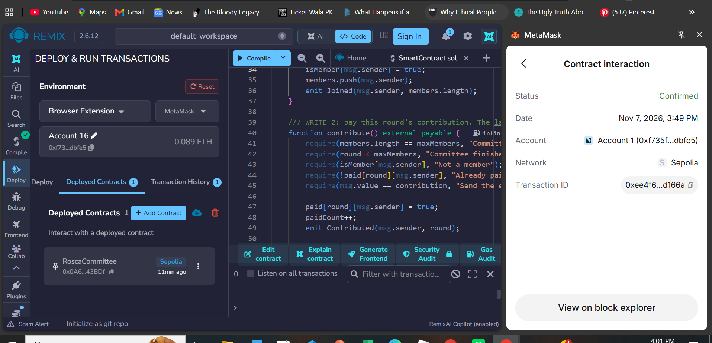
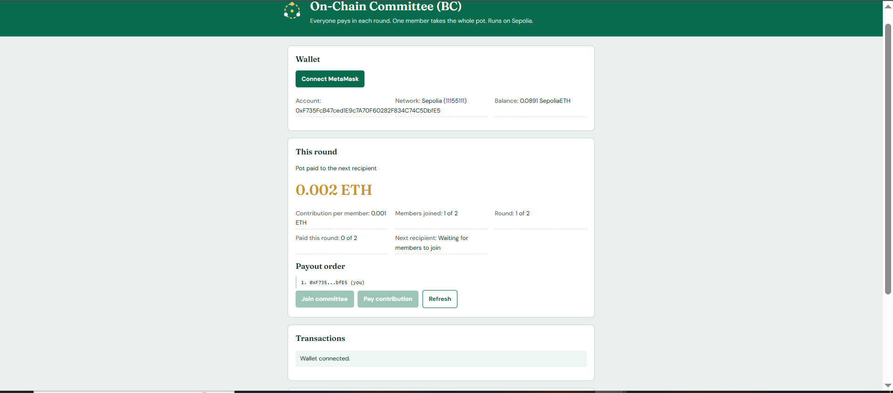
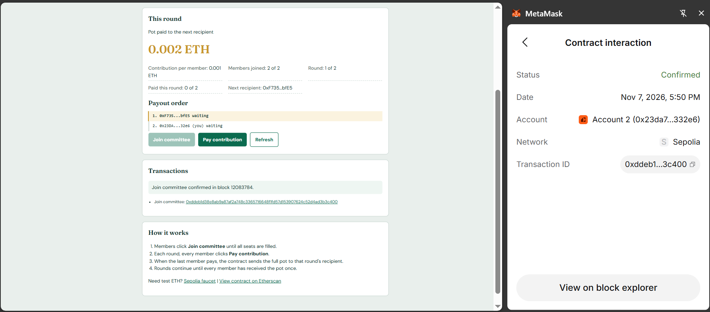
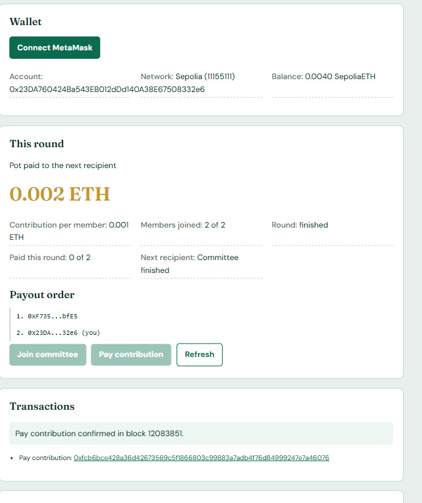
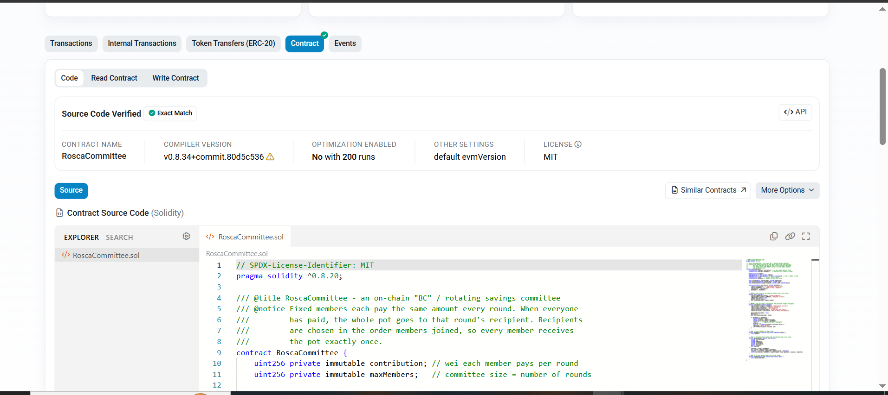

# On-Chain Committee (BC) dApp

**MG3012 Blockchain Technology for Business, Assignment 2**
**Student:** Noor Minallah Chaudhry | **Roll No:** 24i-5579

A small decentralized app that runs a *committee* (also called a BC or ROSCA, a rotating savings group) on the Sepolia testnet. Members each pay the same amount every round, and the whole pot goes to one member per round until everyone has received it once. The smart contract replaces the trusted "committee holder": nobody can run off with the money.

- **Contract address (Sepolia):** `0x0A6c4D6cb33e73b6D291C67F1cEa4dcf30A43BDf`
- **Etherscan:** https://sepolia.etherscan.io/address/0x0A6c4D6cb33e73b6D291C67F1cEa4dcf30A43BDf

## How it works
1. The contract is deployed with a contribution amount and a committee size (for the demo: 0.001 ETH, 2 members).
2. Members call `join()` until all seats are taken. Payout order = join order.
3. Each round every member calls `contribute()` with the exact amount.
4. When the last member pays, the contract sends the full pot to that round's recipient and starts the next round.

## Smart contract functions (`SmartContract.sol`)
| Function | Type | Purpose |
|---|---|---|
| `join()` | write | Take a seat in the committee |
| `contribute()` | write, payable | Pay this round's contribution; last payer triggers the payout |
| `getMembers()` | read | Members in payout order |
| `getRoundInfo()` | read | Contribution, size, members, round, paid count, recipient, finished? |
| `hasPaid(address)` | read | Has this member paid in the current round? |

Safety checks: exact amount only, one payment per member per round, members only, state updated before ETH is sent.

## Frontend (`index.html`, `style.css`, `logo.svg`)
Plain HTML, CSS and JavaScript with **ethers.js v6** (loaded from a CDN). It connects MetaMask, switches to Sepolia, shows wallet and committee info, and lets you join, pay, and see each transaction hash with an Etherscan link.

## Setup
1. Install MetaMask, switch to Sepolia and get test ETH from a faucet.
2. Open `SmartContract.sol` in [Remix](https://remix.ethereum.org), compile (0.8.20 or newer).
3. Deploy with *Injected Provider - MetaMask*, constructor values `1000000000000000` (0.001 ETH in wei) and `2`.
4. Copy the contract address into `CONTRACT_ADDRESS` in `index.html` (and in this README).
5. Open `index.html` with VS Code **Live Server** (do not double-click the file).
6. Connect MetaMask, then join and pay with two accounts to see a full round and payout.

## Screenshots

## Notes and limitations
- Demo project on a testnet; not audited and not for real money.
- Payout order is fixed by join order; there is no late-payment penalty or exit.
- The committee runs once and then finishes.
